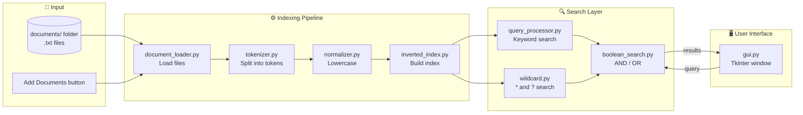
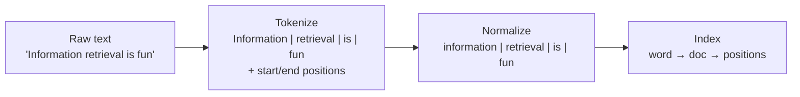
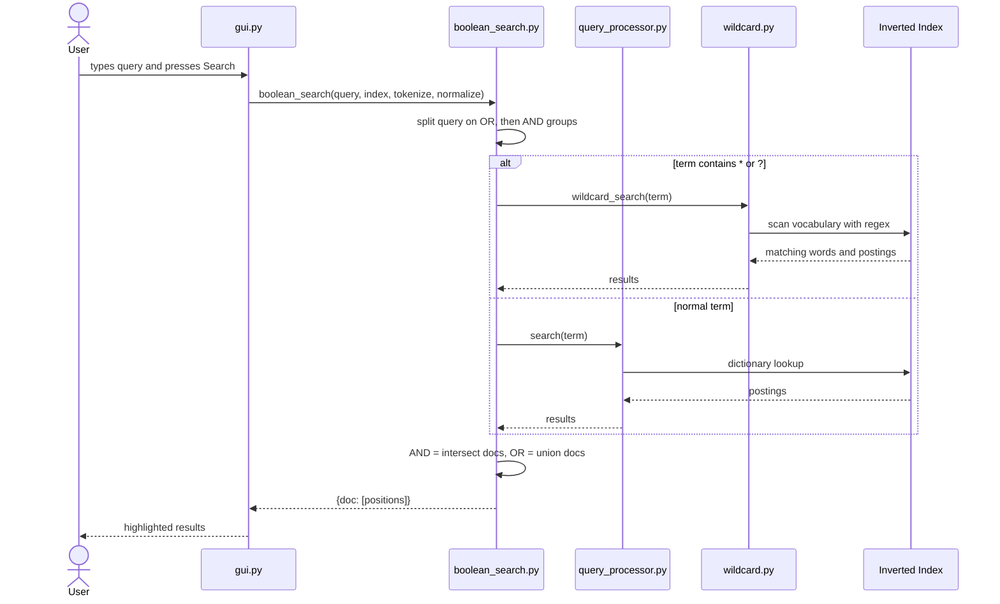
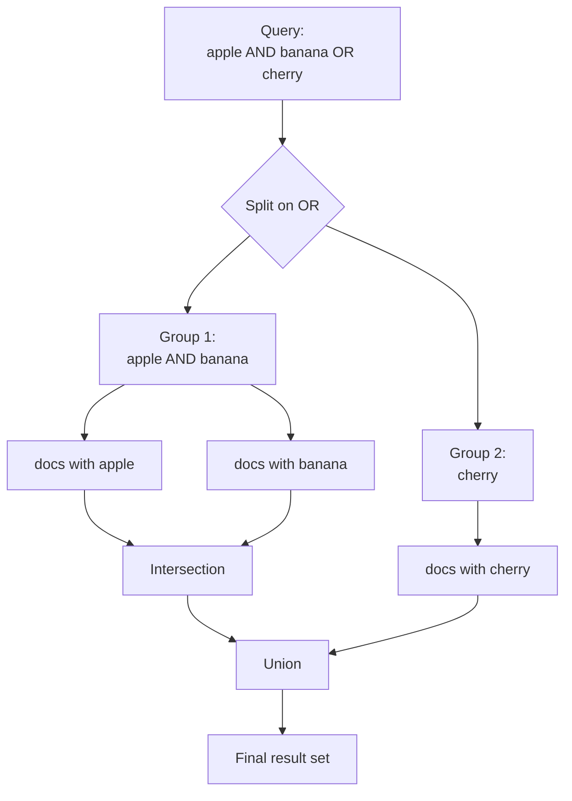
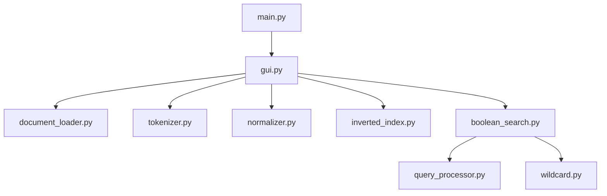
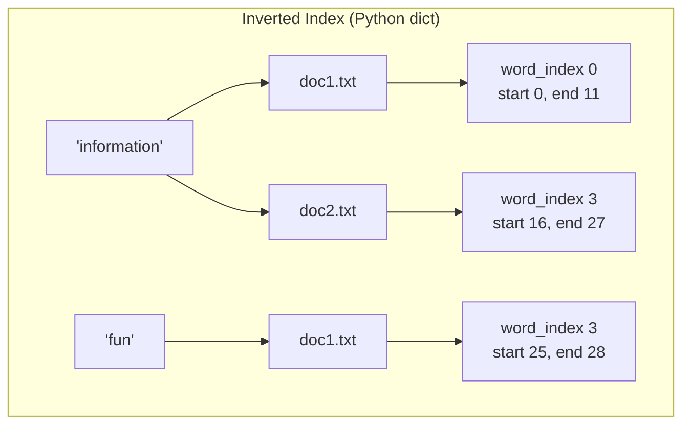

<div align="center">

# 🔎 Information Retrieval System

### A Positional Inverted Index Search Engine with Boolean & Wildcard Queries and a Dark-Themed GUI

**Author:** Ashok Biswal &nbsp;|&nbsp; **Roll No:** B524018

</div>

---

## 📑 Table of Contents

1. [Project Overview](#1--project-overview)
2. [Key Features](#2--key-features)
3. [Core Concepts and Definitions](#3--core-concepts-and-definitions)
4. [System Architecture](#4--system-architecture)
5. [Project Structure](#5--project-structure)
6. [How It Works, Step by Step](#6--how-it-works-step-by-step)
7. [Module-by-Module Explanation](#7--module-by-module-explanation)
8. [Query Language Guide](#8--query-language-guide)
9. [Worked Example](#9--worked-example)
10. [Installation and Running](#10--installation-and-running)
11. [Using the GUI](#11--using-the-gui)
12. [Complexity Analysis](#12--complexity-analysis)
13. [Testing](#13--testing)
14. [Limitations](#14--limitations)
15. [Future Improvements](#15--future-improvements)
16. [Report Writing Guide](#16--report-writing-guide-for-your-documentation)
17. [Viva Questions and Answers](#17--viva-questions-and-answers)
18. [References](#18--references)

---

## 1. 📌 Overview

This project is a small **search engine** for text documents. You put `.txt` files in a folder, the program reads them, builds an **inverted index** that remembers *where* every word occurs, and then lets you search using a graphical interface.

The result screen shows:

- which documents matched,
- how many matches each document has,
- the **word index** and **character positions** of every match,
- the **full document text with every match highlighted** in yellow.

> **Problem it solves:** Scanning every document from start to end for each query is slow. An inverted index flips the problem: instead of "document → words", it stores "word → documents", so a lookup is a single dictionary access.

---

## 2. ✨ Key Features

| Feature | Description |
|---|---|
| 📚 **Positional inverted index** | Stores document name, word index, start and end character for every word |
| 🔤 **Case-insensitive search** | `Apple`, `APPLE` and `apple` are the same term |
| ✳️ **Wildcard search** | `*` matches zero or more characters, `?` matches exactly one |
| 🔀 **Boolean search** | `AND` and `OR` operators, wildcards allowed inside any term |
| 🖍️ **Exact highlighting** | Matches are highlighted using the stored character offsets |
| ➕ **Add documents at runtime** | Load extra `.txt` files from the GUI; the index rebuilds automatically |
| 🌙 **Modern dark GUI** | Built with Tkinter, with a status bar, result counter and scrollable results |
| 🧩 **Modular design** | Tokenizer, normalizer, indexer, search and GUI live in separate files |

---

## 3. 📖 Core Concepts and Definitions

| Term | Definition |
|---|---|
| **Information Retrieval (IR)** | The science of finding relevant material (usually documents) from a large collection that satisfies an information need. |
| **Document** | A single unit of text in the collection (here: one `.txt` file). |
| **Corpus / Collection** | The full set of documents being searched. |
| **Query** | The text the user types to express what they are looking for. |
| **Token** | A single word-like unit extracted from text. Here it carries the word and its start and end position. |
| **Tokenization** | Splitting raw text into tokens. This project uses a regular expression. |
| **Normalization** | Converting tokens into a standard form so that different spellings match. Here: lowercasing. |
| **Term / Vocabulary** | A normalized token stored in the index. The vocabulary is the set of all distinct terms. |
| **Inverted Index** | A data structure mapping each term to the documents (and positions) where it occurs. |
| **Positional Index** | An inverted index that also stores the position of each occurrence, enabling highlighting and phrase search. |
| **Posting** | One entry in the index: a document plus the positions of a term inside it. |
| **Boolean Retrieval** | A retrieval model where a document either matches or does not, using operators such as AND and OR. |
| **Wildcard Query** | A query where special characters stand for unknown characters (`*`, `?`). |
| **Precision** | Fraction of retrieved documents that are relevant. |
| **Recall** | Fraction of all relevant documents that were retrieved. |

---

## 4. 🏗️ System Architecture

### 4.1 High-level architecture



### 4.2 Indexing pipeline



### 4.3 Search flow



### 4.4 How Boolean logic is evaluated



---

## 5. 📂 Project Structure

```text
IR-System/
│
├── main.py                # Entry point: SearchGUI().run()
├── gui.py                 # Tkinter user interface
├── document_loader.py     # Reads all documents from the folder
├── tokenizer.py           # Text → tokens with positions
├── normalizer.py          # Lowercases tokens
├── inverted_index.py      # Builds the positional inverted index
├── query_processor.py     # Plain keyword search
├── wildcard.py            # Wildcard search (* and ?)
├── boolean_search.py      # AND / OR queries (uses the two above)
│
├── documents/             # Put your .txt files here
│   ├── doc1.txt
│   └── doc2.txt
│
└── README.md
```

### Module dependency map



---

## 6. ⚙️ How It Works, Step by Step

### Step 1: Loading documents
At startup, `gui.py` looks for a `documents/` folder beside it. `document_loader.load_documents()` reads every text file and returns a dictionary: `{ "doc1.txt": "full text...", ... }`. More files can be added later with the **Add Documents** button.

### Step 2: Tokenization
`tokenize(text)` uses the regular expression `\b\w+\b` to find every word and records where it sits:

```python
{"word": "Information", "start": 0, "end": 11}
```

Keeping `start` and `end` is what makes exact highlighting possible later.

### Step 3: Normalization
`normalize(tokens)` lowercases every word and keeps the positions untouched, so that searches are case-insensitive.

### Step 4: Building the inverted index
`build_index()` walks through every token and stores:

```text
word → document → list of {word_index, start, end}
```

### Step 5: Searching
- **Keyword:** tokenize and normalize the query, then look the word up in the index (a dictionary access).
- **Wildcard:** convert `*` to `.*` and `?` to `.`, then test the pattern against every word in the vocabulary.
- **Boolean:** split the query into OR groups, split each group into AND terms, run each term, intersect for AND, union for OR.

### Step 6: Displaying results
`gui.py` shows each matching document with its match count, the position of each match, and the full text. `insert_highlighted_document()` uses the `start`/`end` values to highlight every match.

### Index structure



---

## 7. 🧩 Module-by-Module Explanation

| File | Main function | Responsibility |
|---|---|---|
| `main.py` | none | Creates `SearchGUI` and starts the main loop |
| `gui.py` | `SearchGUI` | Window layout, search button, result display, highlighting, adding documents |
| `document_loader.py` | `load_documents(folder)` | Reads text files into a `{name: text}` dictionary |
| `tokenizer.py` | `tokenize(text)` | Regex tokenization with character offsets |
| `normalizer.py` | `normalize(tokens)` | Lowercases words, keeps positions |
| `inverted_index.py` | `build_index(docs, tokenize, normalize)` | Builds the positional inverted index |
| `query_processor.py` | `search(query, index, tokenize, normalize)` | Plain keyword lookup; merges and sorts positions |
| `wildcard.py` | `wildcard_search(query, index, normalize)` | Converts a wildcard pattern to a regex and matches the vocabulary |
| `boolean_search.py` | `boolean_search(...)` | Parses AND/OR and combines per-term results |

### Design decisions

- **Functions are passed in** (`tokenize_function`, `normalize_function`) so the same tokenizer and normalizer are used for both indexing and querying. This avoids mismatches.
- **Positions are stored once** at index time, so highlighting needs no re-searching.
- **Operators are case-sensitive** (`AND`, `OR`), so the ordinary word "and" can still be searched.

---

## 8. 🔤 Query Language Guide

| Query type | Example | Meaning |
|---|---|---|
| Single word | `retrieval` | Documents containing "retrieval" |
| Multiple words | `information retrieval` | Same as AND: documents containing both |
| AND | `apple AND banana` | Documents containing both words |
| OR | `apple OR banana` | Documents containing either word |
| Wildcard `*` | `inform*` | Words starting with "inform" (information, informal...) |
| Wildcard `?` | `f?n` | Three-letter words such as fun, fan, fin |
| Mixed | `inform* AND retriev*` | Wildcards inside Boolean queries |
| Precedence | `a AND b OR c` | Evaluated as `(a AND b) OR c` |

**Rules**

- `AND` and `OR` must be in **CAPITAL letters**.
- `AND` binds tighter than `OR`.
- Searches are **not** case-sensitive for normal words.
- Brackets are not supported.
- `NOT` is not supported yet (see Future Improvements).

---

## 9. 🧪 Worked Example

### Documents

| `doc1.txt` | `Information retrieval is fun` |
|---|---|
| **`doc2.txt`** | **`Inform me about information`** |

### Tokens with positions

| Document | Word | word_index | start | end |
|---|---|---|---|---|
| doc1 | information | 0 | 0 | 11 |
| doc1 | retrieval | 1 | 12 | 21 |
| doc1 | is | 2 | 22 | 24 |
| doc1 | fun | 3 | 25 | 28 |
| doc2 | inform | 0 | 0 | 6 |
| doc2 | me | 1 | 7 | 9 |
| doc2 | about | 2 | 10 | 15 |
| doc2 | information | 3 | 16 | 27 |

### Resulting inverted index

```python
{
  "information": {
      "doc1.txt": [{"word_index": 0, "start": 0,  "end": 11}],
      "doc2.txt": [{"word_index": 3, "start": 16, "end": 27}]
  },
  "retrieval": {"doc1.txt": [{"word_index": 1, "start": 12, "end": 21}]},
  "is":        {"doc1.txt": [{"word_index": 2, "start": 22, "end": 24}]},
  "fun":       {"doc1.txt": [{"word_index": 3, "start": 25, "end": 28}]},
  "inform":    {"doc2.txt": [{"word_index": 0, "start": 0,  "end": 6}]},
  "me":        {"doc2.txt": [{"word_index": 1, "start": 7,  "end": 9}]},
  "about":     {"doc2.txt": [{"word_index": 2, "start": 10, "end": 15}]}
}
```

### Query results

| Query | Result |
|---|---|
| `information` | doc1 and doc2 |
| `information AND retrieval` | doc1 only |
| `fun OR inform` | doc1 (fun) and doc2 (inform) |
| `inform*` | doc1 and doc2 (matches "information" and "inform") |
| `f?n` | doc1 (matches "fun") |
| `information AND fun` | doc1 only |

---

## 10. 🚀 Installation and Running

### Requirements

- Python **3.8 or newer**
- Tkinter (included with the standard Python installer on Windows and macOS)
- No third-party packages

On Linux, install Tkinter if missing:

```bash
sudo apt install python3-tk
```

### Run

```bash
# 1. Go to the project folder
cd IR-System

# 2. Put your .txt files in the documents/ folder

# 3. Start the application
python main.py
```

A minimal `main.py`:

```python
from gui import SearchGUI

if __name__ == "__main__":
    SearchGUI().run()
```

---

## 11. 🖥️ Using the GUI

```text
┌──────────────────────────────────────────────────────────────┐
│  INFORMATION RETRIEVAL                                       │
│  Search your documents quickly and accurately                │
│  ASHOK BISWAL , B524018                                      │
├──────────────────────────────────────────────────────────────┤
│  SEARCH                                                      │
│  ┌──────────────────────────────────────┐ ┌───────────────┐  │
│  │ inform* AND retrieval                │ │    SEARCH     │  │
│  └──────────────────────────────────────┘ └───────────────┘  │
├──────────────────────────────────────────────────────────────┤
│  [ Add Documents ]   Documents: 2                            │
├──────────────────────────────────────────────────────────────┤
│  SEARCH RESULTS   • 1 documents                              │
│ ┌──────────────────────────────────────────────────────────┐ │
│ │ Query: "inform* AND retrieval"                           │ │
│ │ Search Type: Boolean Search                              │ │
│ │                                                          │ │
│ │ doc1.txt                                                 │ │
│ │     Matches found: 2                                     │ │
│ │     Match 1 → Word Index: 0  Characters: 0-11            │ │
│ │     Match 2 → Word Index: 1  Characters: 12-21           │ │
│ │                                                          │ │
│ │     FULL DOCUMENT                                        │ │
│ │     ──────────────────────────────────────────────       │ │
│ │     [Information] [retrieval] is fun    (highlighted)    │ │
│ └──────────────────────────────────────────────────────────┘ │
├──────────────────────────────────────────────────────────────┤
│ ● Boolean Search completed                                   │
└──────────────────────────────────────────────────────────────┘
```

| Control | What it does |
|---|---|
| **Search box** | Type a keyword, wildcard or Boolean query. Press **Enter** or click **SEARCH**. |
| **Add Documents** | Choose one or more `.txt` files; they are added and the index is rebuilt. |
| **Documents counter** | Number of documents currently indexed. |
| **Result counter** | Number of matching documents. |
| **Status bar** | Green means success, red means no results. |
| **Yellow highlight** | Exact matched words inside the document. |

---

## 12. 📊 Complexity Analysis

Let **N** = total words in all documents, **V** = vocabulary size, **L** = average word length, **d** = documents containing a term, **p** = positions of a term.

| Operation | Time | Notes |
|---|---|---|
| Build index | O(N) | One pass through all tokens |
| Keyword lookup | O(1) average + O(p log p) | Dictionary access, then sorting positions |
| Wildcard search | O(V · L) | Every vocabulary word is tested against the regex |
| AND of two terms | O(d₁) | One dict membership test per document |
| OR of two terms | O(d₁ + d₂) | Merge of document sets |
| Memory | O(N) | One position record per word occurrence |

> **Why an inverted index is fast:** a normal scan costs O(total text) per query. With the index, the cost depends only on the number of matches, not on the size of the collection.

---

## 13. ✅ Testing

### Test cases

| # | Query | Expected result | Pass |
|---|---|---|---|
| 1 | `information` | doc1, doc2 | ☐ |
| 2 | `INFORMATION` | Same as 1 (case-insensitive) | ☐ |
| 3 | `xyz123` | "No results found" | ☐ |
| 4 | `information AND retrieval` | doc1 only | ☐ |
| 5 | `fun OR inform` | doc1, doc2 | ☐ |
| 6 | `inform*` | doc1, doc2 | ☐ |
| 7 | `*tion` | Words ending in "tion" | ☐ |
| 8 | `f?n` | doc1 (fun) | ☐ |
| 9 | `inform* AND retriev*` | doc1 only | ☐ |
| 10 | `information AND fun OR about` | (information AND fun) OR about | ☐ |
| 11 | empty query | Warning "Please enter a search query" | ☐ |
| 12 | no documents loaded | Warning "No documents are available" | ☐ |
| 13 | Add Documents, then search a new word | New document appears in results | ☐ |

### Quick script test (no GUI)

```python
from tokenizer import tokenize
from normalizer import normalize
from inverted_index import build_index
from boolean_search import boolean_search

docs = {
    "doc1.txt": "Information retrieval is fun",
    "doc2.txt": "Inform me about information",
}

index = build_index(docs, tokenize, normalize)

print(boolean_search("information AND retrieval", index, tokenize, normalize))
print(boolean_search("fun OR inform*", index, tokenize, normalize))
```

---

## 14. ⚠️ Limitations

- Only **AND** and **OR**; no `NOT` and no brackets.
- **No ranking:** results are not sorted by relevance, since Boolean retrieval is match or no match.
- **No stemming or stop-word removal:** "run" and "running" are different terms.
- **No phrase search:** `"information retrieval"` as an exact phrase is not supported, although the stored `word_index` makes it possible to add.
- Wildcard search scans the whole vocabulary, so it is slower on very large collections.
- Only plain-text `.txt` files are supported, and the index lives in memory (it is rebuilt each time the app starts).
- Contractions and hyphenated words are split by the default tokenizer (`don't` becomes `don` and `t`).

---

## 15. 🔮 Future Improvements

| Idea | Benefit |
|---|---|
| `NOT` operator and brackets | Full Boolean query language |
| Phrase search using `word_index` | Exact phrase matching |
| Proximity search (`A NEAR/3 B`) | Words within a distance |
| **TF-IDF / BM25 ranking** | Sort results by relevance |
| Stemming and stop-word removal | Better recall |
| Permuterm or k-gram index | Much faster wildcard search |
| Save and load the index to disk (JSON or pickle) | Faster startup |
| PDF and DOCX support | More document types |
| Snippet view instead of the full document | Easier reading |
| Spelling correction ("Did you mean...?") | Better user experience |

---

## 16. 📝 Report Writing Guide (for your documentation)

Use this as the skeleton for your project report. Each chapter lists what to write.

### Suggested report structure

| Chapter | Title | What to include |
|---|---|---|
| **Front pages** | Title page, certificate, declaration, acknowledgement, abstract, table of contents, list of figures and tables | Name: Ashok Biswal, Roll: B524018, course, guide, institute, date |
| **1** | **Introduction** | Background of IR, problem statement, motivation, objectives, scope |
| **2** | **Literature Survey / Theory** | Boolean model, inverted index, positional index, tokenization, normalization, wildcard handling, comparison with other models (vector space, probabilistic) |
| **3** | **System Analysis** | Functional requirements (index, search, highlight, add documents), non-functional requirements (speed, usability), hardware and software requirements |
| **4** | **System Design** | Architecture diagram (section 4), module diagram, data flow diagrams, index structure, class diagram of `SearchGUI`, algorithms (pseudo-code below) |
| **5** | **Implementation** | Technologies (Python, Tkinter, `re`), description of every module and its main functions, key code snippets, screenshots |
| **6** | **Testing and Results** | Test cases table (section 13), screenshots of each query type, observations |
| **7** | **Conclusion and Future Work** | Summary, achievements, limitations, future scope |
| **Back pages** | References, appendix | Full source code, sample documents, user manual |

### Abstract (sample you can adapt)

> This project presents an Information Retrieval System built in Python with a Tkinter graphical interface. Documents are tokenized with a regular expression, normalized to lowercase, and stored in a positional inverted index that records the document, word index and character offsets of every term. The system supports keyword, wildcard (`*`, `?`) and Boolean (`AND`, `OR`) queries and displays the retrieved documents with every match highlighted at its exact position. The design is modular, allowing components such as ranking, stemming and phrase search to be added later. Testing on sample text collections shows correct retrieval for all supported query types.

### Problem statement (sample)

> Searching large text collections by scanning every document is inefficient. There is a need for a system that preprocesses documents into an index structure so that queries are answered quickly, and that supports flexible query types such as Boolean and wildcard queries while showing users exactly where each match occurs.

### Objectives

1. Build a positional inverted index from a collection of text documents.
2. Support case-insensitive keyword retrieval.
3. Support wildcard queries using `*` and `?`.
4. Support Boolean queries with `AND` and `OR`.
5. Provide a GUI that highlights matches and shows their positions.
6. Allow new documents to be added at runtime.

### Algorithms (pseudo-code for the report)

**Algorithm 1: Build index**
```text
FOR each document D in collection:
    tokens  = TOKENIZE(text of D)            # word, start, end
    tokens  = NORMALIZE(tokens)              # lowercase
    FOR i, token in enumerate(tokens):
        index[token.word][D].append({word_index: i,
                                     start: token.start,
                                     end: token.end})
RETURN index
```

**Algorithm 2: Keyword search**
```text
tokens = NORMALIZE(TOKENIZE(query))
results = {}
FOR each token in tokens:
    IF token.word in index:
        FOR each (doc, positions) in index[token.word]:
            results[doc].extend(positions)
SORT positions of each doc by start
RETURN results
```

**Algorithm 3: Wildcard search**
```text
pattern = NORMALIZE(query)
regex   = replace '*' with '.*', '?' with '.', escape all other characters
FOR each word in index:
    IF FULLMATCH(regex, word):
        merge index[word] into results
RETURN results
```

**Algorithm 4: Boolean search**
```text
groups = split query tokens at 'OR'                # each group = list of terms
final  = {}
FOR each group:
    group_result = None
    FOR each term in group:
        r = wildcard_search(term) IF term has * or ? ELSE search(term)
        IF group_result is None:  group_result = r
        ELSE:                     group_result = documents present in BOTH
    merge group_result into final                  # OR = union
remove duplicate positions, sort by start
RETURN final
```

### Figures and tables to include in the report

| Figure / Table | Source |
|---|---|
| Fig 1: System architecture | Section 4.1 |
| Fig 2: Indexing pipeline | Section 4.2 |
| Fig 3: Search sequence diagram | Section 4.3 |
| Fig 4: Boolean evaluation | Section 4.4 |
| Fig 5: Index structure | Section 6 |
| Fig 6 to 10: GUI screenshots (keyword, wildcard, Boolean, no result, add documents) | Take from the running app |
| Table 1: Query syntax | Section 8 |
| Table 2: Complexity | Section 12 |
| Table 3: Test cases | Section 13 |
| Table 4: Module description | Section 7 |

### Screenshots checklist

- [ ] Home screen on startup
- [ ] Keyword search result with highlights
- [ ] Wildcard `*` result
- [ ] Wildcard `?` result
- [ ] `AND` result
- [ ] `OR` result
- [ ] Mixed wildcard and Boolean result
- [ ] "No results found" screen
- [ ] Empty query warning
- [ ] After using **Add Documents**

### Comparison table (useful for the literature chapter)

| Aspect | Boolean (this project) | Vector Space (TF-IDF) | Probabilistic (BM25) |
|---|---|---|---|
| Result type | Match / no match | Ranked list | Ranked list |
| Ranking | No | Yes | Yes |
| Query style | Exact logic (AND, OR) | Free text | Free text |
| Control for user | High | Medium | Medium |
| Complexity | Low | Medium | Medium |

---

## 17. 🎓 Viva Questions and Answers

**Q1. What is an inverted index?**
A structure that maps each term to the documents (and positions) where it appears, so searching needs no full scan.

**Q2. Why "inverted"?**
A normal index maps document → words. This one inverts it: word → documents.

**Q3. What makes your index "positional"?**
It stores `word_index`, `start` and `end` for each occurrence, which enables exact highlighting and could support phrase search.

**Q4. Why do you normalize tokens?**
So "Apple" and "apple" map to the same term, which improves recall.

**Q5. How does wildcard search work?**
The `*` and `?` are converted to regex (`.*` and `.`), and the regex is tested against every term in the vocabulary. Matching terms' postings are merged.

**Q6. How is AND implemented? OR?**
AND keeps only documents present in both term results (intersection). OR combines the documents of both (union).

**Q7. What is the operator precedence?**
`AND` before `OR`, so `a AND b OR c` means `(a AND b) OR c`.

**Q8. Why must AND/OR be uppercase?**
So the ordinary English words "and" and "or" can still be searched as normal terms.

**Q9. What is the time complexity of lookup?**
O(1) average for the dictionary access, because the index is a hash map.

**Q10. What are the weaknesses?**
No ranking, no `NOT`, no brackets, no stemming, no phrase search, and wildcard search scans the whole vocabulary.

**Q11. How would you add ranking?**
Count term frequency per document, compute IDF, and sort results by TF-IDF or BM25 score.

**Q12. How would you add phrase search?**
Find documents containing all words, then check that their `word_index` values are consecutive.

**Q13. Difference between precision and recall?**
Precision = relevant retrieved / total retrieved. Recall = relevant retrieved / total relevant.

---

## 18. 📚 References

1. C. D. Manning, P. Raghavan, H. Schütze, *Introduction to Information Retrieval*, Cambridge University Press, 2008. Free online at <https://nlp.stanford.edu/IR-book/>
2. R. Baeza-Yates, B. Ribeiro-Neto, *Modern Information Retrieval*, Addison-Wesley.
3. Python documentation: `re` module, <https://docs.python.org/3/library/re.html>
4. Python documentation: Tkinter, <https://docs.python.org/3/library/tkinter.html>

---

<div align="center">

**Made with Python 🐍 by Ashok Biswal (B524018)**

⭐ *Information Retrieval System, 2026*

</div>